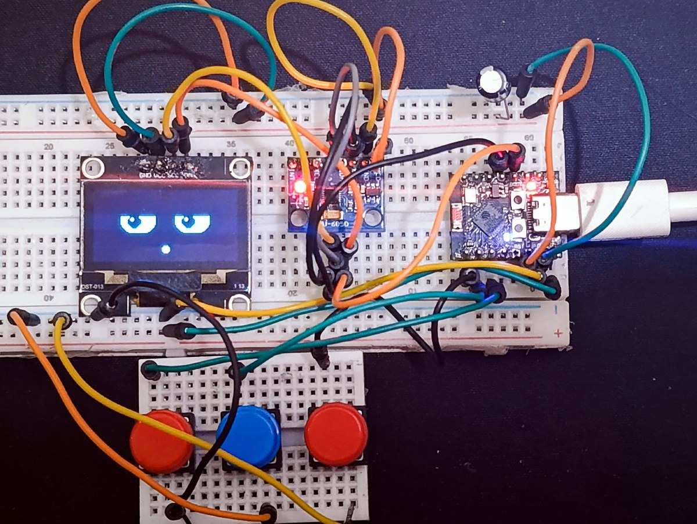
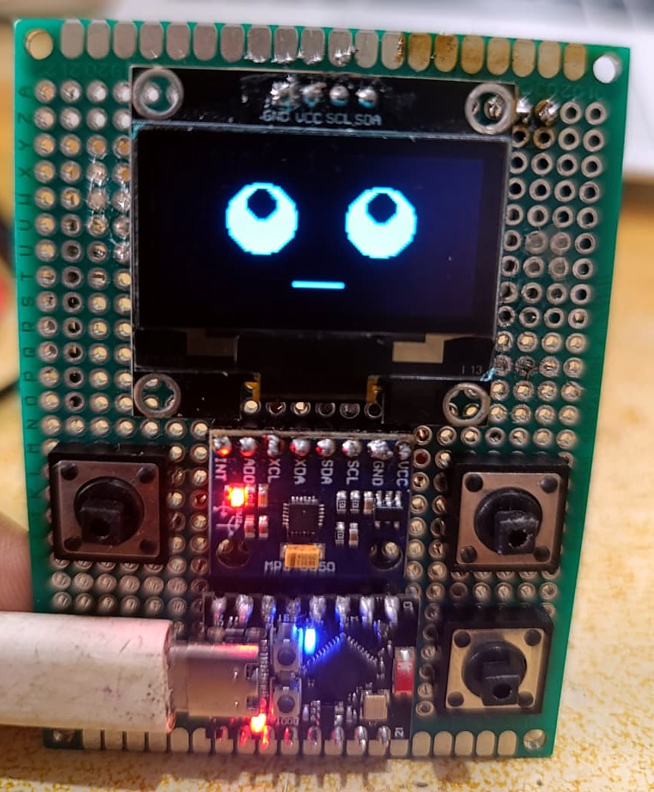
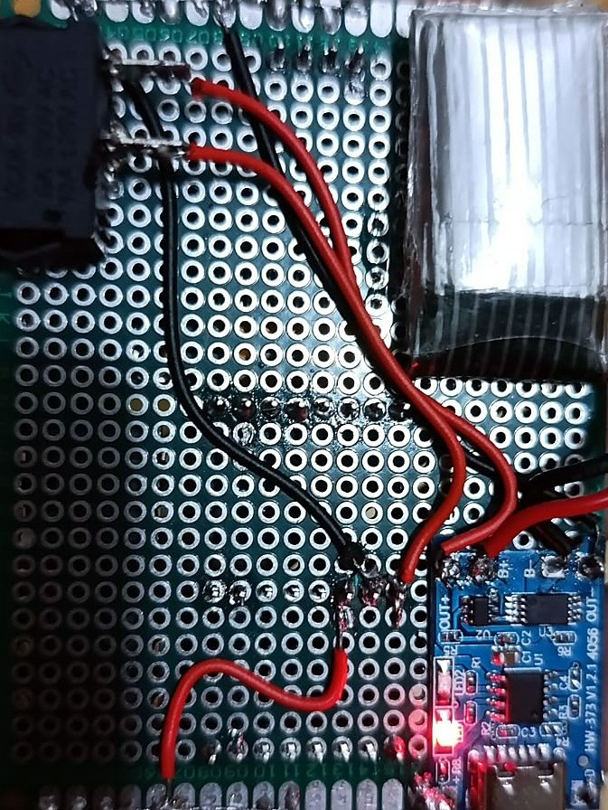
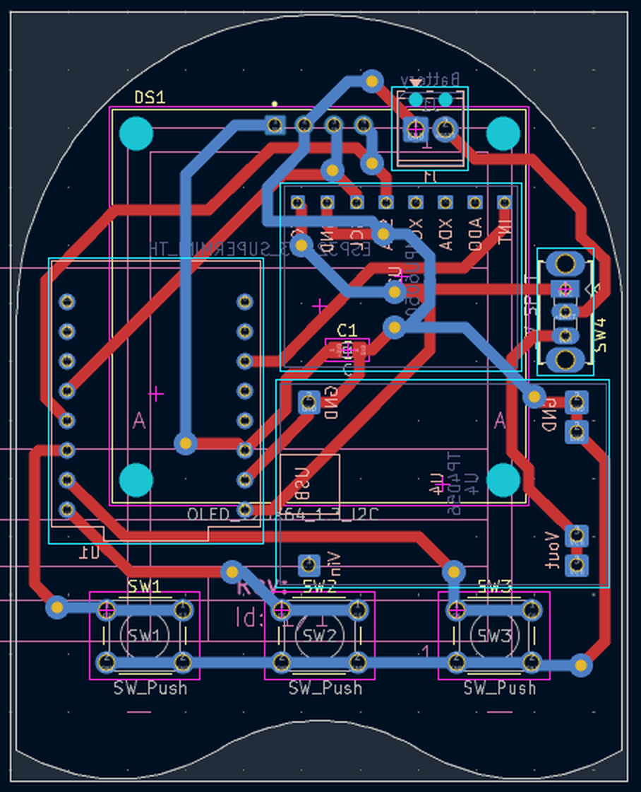
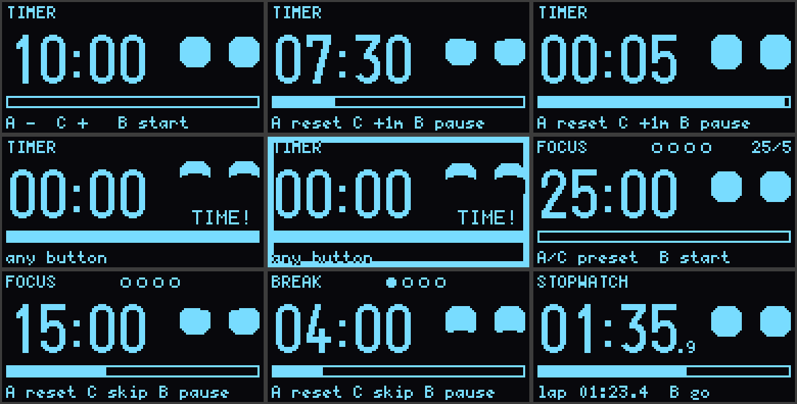
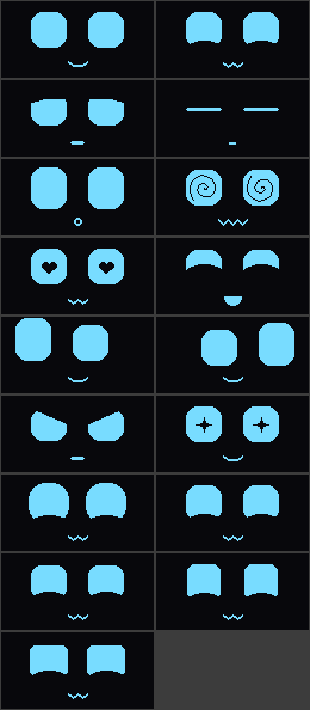
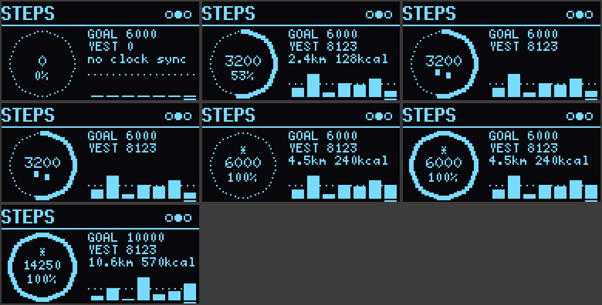
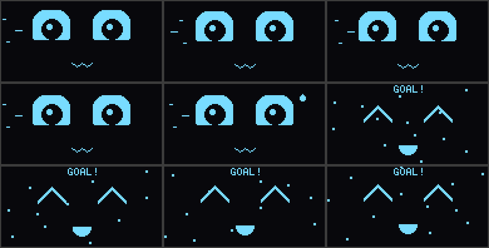
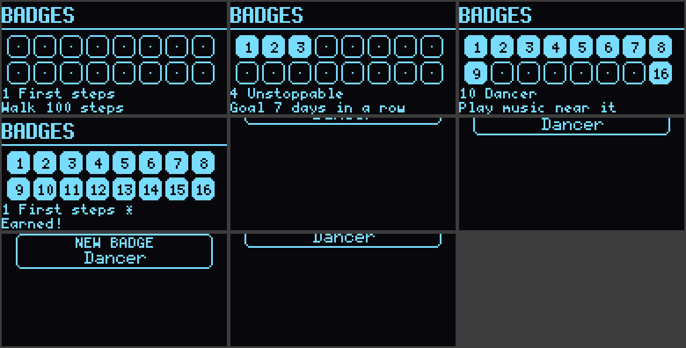

# Pocketpet.esp32c3

> **Status (2026-11-15): firmware verified on the device, PCB ordered.** Salman flashed and tested the current
> `main` (pet music reactions, games, launcher, Online, Spotify, Lyrics visual) and confirmed it all works. The custom
> PCB is finalised and ordered (`PCB/` holds the KiCad project). See `HANDOFF.md` for details.
> Do not start big new features unless Salman asks.

Keychain-sized digital pet gadget built around an ESP32-C3 Super Mini with a 1.3" SH1106 OLED, MPU6050 motion sensor, touch input and three buttons.

## Build gallery

The project over time, from first prototype to the final PCB.

| | |
|---|---|
|  |  |
| **1. Breadboard prototype.** ESP32-C3 Super Mini, OLED, MPU6050 and three buttons on jumper wires. | **2. Vero board, front.** Everything soldered to one board: OLED on top, MPU6050 in the middle, ESP32-C3 at the bottom, three buttons. |
|  |  |
| **3. Vero board, back.** Rocker switch, TP4056 charger and the 800 mAh battery. | **4. The final custom PCB** (KiCad layout, ghost-shaped outline), ordered 2026-11-15. |

## Current hardware wiring

> **Custom PCB v1:** its button pins differ from the table below and it needs a few bodge wires. Flash it with the PlatformIO environment `esp32-c3-pcb`. All details and the fixes are in [`docs/pcb-v1-notes.md`](docs/pcb-v1-notes.md).

**Important:** the OLED and MPU6050 share **one hardware I2C bus (`Wire`)** on GPIO 8 (SDA) and GPIO 9 (SCL), 400 kHz. They have different addresses (OLED `0x3C`, MPU6050 `0x68`), so they coexist on the same two wires. (Until 2026-11-09 the MPU6050 was on its own software I2C bus on GPIO 5/6; that is gone and GPIO 5/6 are free.)

| Part | Pin | ESP32-C3 GPIO | Notes |
|------|-----|---------------|-------|
| OLED SH1106 + MPU6050 | SDA | **8** | Shared hardware I2C, 400 kHz |
| OLED SH1106 + MPU6050 | SCL | **9** | Shared hardware I2C, 400 kHz |
| Button A | one leg to GND | **2** | Up / previous / tickle |
| Button B | one leg to GND | **1** | Select / back |
| Button C | one leg to GND | **0** | Down / next / boop |
| Touch pad | OUT | **4** | TTP223-style, HIGH when touched (the pin next to 3V3) |

Wire the MPU6050 SDA/SCL to the same GPIO 8 / 9 pins as the OLED.

### I2C addresses
- OLED: `0x3C`
- MPU6050: `0x68`

### GPIO notes
- GPIO 8 and GPIO 9 are ESP32-C3 strapping pins (they are also the C3's default I2C pins). The OLED has been tested on them. If the board ever becomes unreliable during boot, investigate these pins first.
- GPIO3 is the only free ADC1 pin left. Keep it for the battery voltage divider.
- GPIO 0-5 can wake the C3 from deep sleep, so the touch pad (GPIO4) and buttons (0, 1, 2) all work for wake-up later.

## Current firmware

### Home and menu
The **pet is the home screen**: it is what you see when the keychain turns on and where it returns to when you leave it alone (the launcher goes back to the pet after 20 s without input; holding B in the launcher also goes home). **Press B on the pet** to open the launcher, which has two styles you pick in **Settings > Menu style**:
- **Carousel** (default): big icons slide in from the right; **A** = previous, **C** = next, **B** = open.
- **Tilt ring**: the apps sit on a ring; **tilt the keychain toward an app** to highlight it, **B** opens it (A/C also step through them).

In the launcher: Fluid, Stats, Motion test, Tools, Games, Online, Spotify, Visualizer (Lyrics visual), Living OLED, Settings. While it starts, the MPU6050 calibrates itself in the background (gyro offsets, and which way is "down" from gravity), so tilt works however the sensor sits on the board and however you hold the keychain; in Pet mode it re-levels itself when you hold it still in a new pose. Every sub-menu (Tools, Games, Settings and the Online list) uses the same carousel / tilt-ring look as the home screen: **A/C** move, short **B** opens, **hold B** goes up one level, and each one ends with a **Back** item. Settings shows the current value in a pill under the name; Games shows your best score. Tools contains Temperature, Timer, Pomodoro, Stopwatch, Magic 8-ball and Dice (shake the keychain to roll / ask).

### Timer, Pomodoro, Stopwatch
Three clocks in Tools. Each page shows the time in big digits, a progress bar and **the pet's little face reacting**: serious while you focus, wide-eyed for the last 10 seconds, relaxed on a break, jumping with happy eyes when time is up. They keep running in the background (a running timer counts down in the corner of the pet screen); when one finishes the screen wakes up, opens the clock and the border blinks (there is no buzzer on the board, so the alert is visual; any button dismisses it).
- **Timer:** A / C set the minutes (1 to 180), **B** start / pause, while running A resets and C adds a minute.
- **Pomodoro:** A / C pick a preset (25/5, 50/10, 15/3), B starts. Focus, then a break that starts by itself, four dots show your rounds, and after the fourth round the break is 3x longer. C skips the phase, A resets. Every finished focus session counts toward growth and the Focused badge, and the pet gets happier.
- **Stopwatch:** B start / stop, C lap (shows the last lap), A reset. Tenths of a second, and a bar that sweeps once a minute.
- Hold B (0.7 s) goes back to Tools; the clock keeps running.

### Games
Built for the three buttons and the MPU6050. Best scores are saved.

| Game | Controls |
|------|----------|
| **Star Blaster** (side-scrolling shooter: drones, gunships, splitting rocks, power-ups) | tilt flies the ship, **A** shoots (hold = rapid fire), **C** = smart bomb |
| **Sniper** (night city, scope with sway; enemies pop up in big windows, 2.4 s+ to find and shoot them, survive 3 misses; a ring blip shows where off-screen targets are) | tilt swings the scope, **A** fires (bolt action), hold **C** to steady your breath and zoom 2x |
| **Road Rush** (pseudo-3D racer, beat the clock, checkpoints add time; traffic = hollow sedans and tall trucks, your car is solid) | tilt steers (quick, full lock at about a 0.5 tilt; bends push you outwards), **A** nitro, **C** brake |
| **Pinball** (the table lies on its side, flippers on the right edge) | **A** upper flipper, **C** lower flipper, shake the keychain to nudge the ball (nudge too much = TILT) |
| **Breakout** (8x5 bricks, top rows take two hits, levels get faster and gappier) | tilt slides the paddle, **A** or **C** launches |
| **Asteroids** (screen wraps, rocks split) | tilt turns the ship, hold **A** thrust, hold **C** fire |
| **Stack** (drop the sliding block, only the overlap stays, 3 perfect drops in a row grow it back) | **A** or **C** drops (no tilt needed) |
| **Quick Draw** (wait for DRAW!, beat the outlaw, he gets faster every win; too early loses) | **A** or **C** (no tilt needed) |
| **Tilt Maze** | tilt, **A** re-zero, **C** new maze |
| **Snake** | tilt to steer (or **A** left / **C** right) |

Online has 12 screens that need the internet (see below). Copy `src/secrets.example.h` to `src/secrets.h` and set `WIFI_SSID` / `WIFI_PASSWORD` locally first. The touch pad only works in Pet mode.

### Settings
Brightness (4 steps), Screen off (Off / 30 s / 1 min / 5 min; any button, touch or movement wakes it), Flip screen (180 degrees), Menu style (carousel / tilt ring), Lyrics sync (shift lyric timing earlier or later), Music pet (On / Off, see Pet mode), Step goal (4000 / 6000 / 8000 / 10000 / 12000), Reset pet (press B twice), Back. All of them are saved to flash.

### Online mode
Wi-Fi stays **off** everywhere except Online mode. Entering Online connects **once** (up to 3 automatic attempts, then each request is retried up to 3 times for random network hiccups), fetches everything for every screen in one go, and stays connected while you browse. Leaving Online switches the radio off. The list header shows the state: `wifi 2/3`, `sync 4/9`, `online`, `offline`. Every screen shows how old its data is (top right). If a refresh fails you keep the last good data.

**Several Wi-Fi networks:** list them in `secrets.h` with `WIFI_NETWORKS` (see `src/secrets.example.h`), for example home, uni and your phone hotspot. On entering Online it scans, tries the strongest known network first and falls back to the others by itself. Net status shows which one it picked. 2.4 GHz networks only.

Controls: in the list, A/C move and B opens (**Sync now** refetches everything, **Back** leaves). On a screen, **A = refresh this screen** (no reconnect), **C = next screen**, **B = back to the list**, touch = Home.

| Screen | Source (no API keys) | Refreshes |
|--------|----------------------|-----------|
| Clock | NTP (`pool.ntp.org`), keeps ticking offline | synced on connect, resync every 6 h |
| Weather | Open-Meteo | 30 min |
| Forecast | same request as Weather | 30 min |
| Air quality | Open-Meteo air quality (US AQI, PM2.5) | 30 min |
| Currency | open.er-api.com (USD to `CURRENCY_HOME`, EUR, GBP) | 6 h |
| World clocks | computed from NTP time, with DST rules for London, New York, Tokyo, Sydney | no request |
| Random fact | uselessfacts.jsph.pl | once per visit, A = new one |
| Advice | adviceslip.com | once per visit, A = new one |
| Moon phase | calculated from the date (approximate, within about a day) | no request |
| Net status | RSSI, IP, a `generate_204` check with ping time | every 20 s while open |
| ISS tracker | api.open-notify.org (plain HTTP) | every 60 s while open |
| GitHub | api.github.com stars, forks, issues, last push | 10 min |

Location for weather and air quality comes from an IP lookup (ip-api.com) unless you set `LOCATION_LAT` / `LOCATION_LON` in `secrets.h`. See `src/secrets.example.h` for all optional overrides.

**Pet reactions:** when cached data exists, Pet mode shows tiny corner icons: sweat drop (35 C or hotter), umbrella (rain chance 60% or more), cloud (AQI 150 or more), moon (after sunset). Each successful fetch also gives the pet a small happiness bump.

Requests are blocking with a 7 second timeout, so the screen can pause briefly while one runs. A progress frame is drawn first so it never looks frozen. Background refresh while you are in Online: weather and air quality every 30 min, currency 6 h, GitHub 10 min. Net status and ISS only refresh while you are looking at them.

**Connection problems:** many ESP32-C3 Super Mini boards fail to connect at full TX power, so the firmware lowers it to 8.5 dBm by default. If your router is far away and the signal is weak, put `#define WIFI_TX_POWER WIFI_POWER_11dBm` (or `WIFI_POWER_19_5dBm`) in `src/secrets.h`.

### Spotify mode
Shows what is playing on your Spotify (any device: phone, PC, speaker), with **synced lyrics** from LRCLIB, and controls it: **A** previous, **B** play/pause, **C** next. **Hold B** (0.7 s) = back to the menu. The screen stays on while you are in this mode. Needs Spotify **Premium** for the buttons (viewing works without) and the Wi-Fi from `secrets.h`. Spotify itself must be playing somewhere; the keychain is a remote, not a speaker.

One-time setup (on your PC):
1. https://developer.spotify.com/dashboard -> Create app (any name, Web API). Add the Redirect URI exactly `http://127.0.0.1:8888/callback`. Copy the Client ID.
2. `python tools/spotify_auth.py YOUR_CLIENT_ID --write` (opens a Spotify login page, then writes `SPOTIFY_CLIENT_ID` and `SPOTIFY_REFRESH_TOKEN` into `src/secrets.h`, which Git ignores).
3. Build and flash. If it says the login expired (about every 6 months), run step 2 again.

Notes: Spotify apps in development mode need the app owner to have Premium and allow 5 users, which is plenty for one keychain. The screen can freeze for about a second when a song changes (a new secure connection for the lyrics), that is normal. Not every song has synced lyrics; those show the title and artist instead.

### Lyrics visual mode
Uses the same Spotify session as Spotify mode but shows the lyrics as an animated "reel": one word at a time in an outlined box, over procedural monochrome scenes (16 of them: starfield, tunnel, ripples, spectrum bars and more), with box entrances, inverted flashes and transitions. Which word is shown follows estimated or (when LRCLIB has them) real per-word timing. **A / C** skip tracks, short **B** play/pause, **hold B** back to the menu. Needs the same Spotify setup as above.

### Living OLED mode
An ambient screensaver: six animated scenes (flow, orbit, field, rain, mesh, terrain). **A / C** next scene, **B** pause / play, hold B to leave.

### Fluid mode
Particle water simulation that follows tilt. Hold the device like a phone, it calibrates for half a second (that pose counts as level). A = re-zero, C = Water / Honey / Mercury, B = back.

### Pet mode (companion style, nothing can die)
- **RoboEyes-style eyes** (own implementation in `src/pet_face.cpp`, no library needed): solid rounded eyes with no pupils, eased movement, random blinks (sometimes double), the odd wink, and the eyes slide around when idle or follow the tilt. When it looks sideways the outer eye grows a little (curious). Tired lids when sleepy, angry lids for rock, rounded "hump" eyes when happy. The things RoboEyes does not have are drawn in the same style: spiral eyes (dizzy), heart eyes (love), star eyes (dreamy), the mouths, hearts and Zzz.

- **Moods:** neutral, happy, sleepy (low energy or no activity for 30 s, tired lids and yawns), asleep (no activity for 60 s, with floating Zzz). **The pet never gets sad:** ignoring it does not hurt, it just falls asleep, and after 10+ minutes away it is delighted to see you (heart eyes). Happiness (the Mood bar, never below 40) goes up from petting, steps, music and your daily goal and settles back to a calm baseline; a good day of steps yesterday and steps so far today raise that baseline.
- **Touch:** tap = love face and hearts. Hold the pad for 0.6 s = purr, which keeps raising happiness.
- **Motion:** shake = dizzy spiral eyes. A sharp pickup, bump or drop = surprised.
- **Buttons in Pet mode:** A = tickle (laughs), C = boop (surprised), B = back to the menu.
- Any touch, button press or movement wakes it up.
- **Music pet (Settings > Music pet, default On):** while Spotify is playing, Pet mode quietly opens a Spotify session (Wi-Fi, so it costs battery; it drops when the screen turns off or you leave Pet mode) and the pet dances to the song. The reaction depends on the vibe: **Chill** (eyes closed, headphones, slow sway), **Pop** (happy eyes, bounce, notes and sparkles), **Hype** (shades, head nods, impact lines), **Rock** (angry eyes, headbang, lightning), **EDM** (big pulsing pupils, equalizer, strobe on the bar), **Desi** (dreamy eyes, wide sway, hearts), **Dreamy** (starry eyes, twinkles). The mouth flaps on sung words. The vibe name flashes briefly when a track starts; a trailing **?** means it was guessed (no genre data) from the title and lyric speed. The beat is a steady feel-tempo per vibe locked to the song position, not the song's real BPM (Spotify no longer gives tempo).

### Step counter
The MPU6050 counts your steps all the time, in every mode and with the screen off, using the same 50 Hz motion loop the rest of the firmware uses (no extra hardware). The detector (`src/steps.cpp`) smooths the accelerometer magnitude, subtracts gravity, adapts its threshold to how hard you walk and only starts counting once the rhythm looks like walking (4 peaks 0.3 to 1.0 s apart, the first four are credited afterwards). Shaking, tapping and playing games / Fluid / Tilt Maze / Snake / Dice / 8-ball never count. Hanging off a bag or in a pocket both work.

- **Stats > STEPS page** (press A or C on Stats): a ring of ticks that fills toward your goal and flashes when you hit it, today's count and percent (two little feet take turns while you walk), the goal, yesterday, distance and kcal (rough: 0.75 m and 0.04 kcal per step) or your cadence while walking, and the last 7 days as bars with the goal as a dotted line.
- **The pet reacts:** while you walk it strolls along (happy face, bounces on every step, speed lines, a sweat drop when you jog), every 50 steps it gets happier, and when you reach the goal it jumps with confetti and a blinking GOAL! (+15 happiness).
- **Saved to flash** as one small blob (today + 6 days), every 100 steps or 5 minutes, and on a new day or goal. Days roll over by the date once the clock has synced over Wi-Fi (Online or Spotify); with no clock the day rolls after 24 h of uptime and the Steps page says "no clock sync". Goal: Settings > Step goal.
- Tested on the PC with simulated walking, jogging, idle, fidgeting and shaking: `bash tools/steptest/run.sh`, screens: `bash tools/steptest/build_preview.sh`.

### Growth, streaks and badges
- **Growth:** the pet earns XP from steps (1 per 50), petting (2), songs it danced to (25), games (10) and finished focus timers (40). It grows through five stages, **Bit, Byte, Kilo, Mega, Giga** (at 0 / 300 / 1200 / 3000 / 7000 XP), and its eyes change with the stage (big and round as a Bit, wider and squarer later). Growing up gives a confetti jump and a toast.
- **Streak:** days in a row you reached the step goal. A flame with the number shows next to the goal on the Steps page. A missed day resets it.
- **16 badges** (Stats > BADGES, press C twice): First steps, Goal getter, On a roll (3 days), Unstoppable (7), 10K day, Wanderer (10k steps total), Marathoner (100k), Best friend (100 pets), Cuddle king (1000), Dancer, Gamer (10 games), Focused (5 focus timers), Kilo, Mega, Giga, Collector (all of them). Earned ones are solid with their number; the line below cycles through names and hints. A toast slides in from the top when you earn one.
- A thin line along the bottom edge of the pet screen fills toward today's step goal (dotted when reached).

### Stats
Happiness and energy are saved to flash (about every 2 minutes when they changed, and when leaving Pet mode), so the pet remembers across reboots. The Stats screen shows both bars and a lifetime pet count. **A or C flips pages: pet, steps, badges, System.** The System page has the numbers that matter for debugging: FPS (frames sent to the OLED, capped at 25), how often `loop()` runs, free heap, lowest free heap since boot, the largest free block (the real limit for a TLS connection), app size, uptime and why the chip last restarted. Open it before and after using Online or Spotify to see how much heap they eat.

### Other
- Button debouncing with press events.
- MPU6050 and OLED are re-checked every 2 seconds and recover if they drop out.
- Serial diagnostics once a second (buttons, touch, OLED, MPU, happy, energy, pets, fps, free / min heap and largest free block in KB).
- GitHub Actions (`.github/workflows/build.yml`) builds the firmware with PlatformIO on every push and shows the RAM / flash usage in the run summary.

## Build

1. Install PlatformIO in VS Code.
2. Open this folder (it will download U8g2 and ArduinoJson).
3. Plug the ESP32-C3 Super Mini in with a data-capable USB cable.
4. Build and upload with PlatformIO.
5. Board environment: `esp32-c3-supermini`.
6. USB CDC on boot is enabled in `platformio.ini`. Use environment `esp32-c3-supermini` for the protoboard build and `esp32-c3-pcb` for the custom PCB.
7. `partitions.csv` gives the app a 3 MB slot (no OTA) because Wi-Fi + TLS made the firmware too big for the default 1.3 MB slot.

## Files
- `src/main.cpp` -> main firmware: hardware init, input, MPU6050 handling, pet logic and drawing, Stats, Tilt Maze, Snake, mode switching
- `src/games.h` / `src/games.cpp` -> the 8 games (Star Blaster, Sniper, Road Rush, Pinball, Breakout, Asteroids, Stack, Quick Draw)
- `src/launcher.h` / `src/launcher.cpp` -> home menu and all sub-menus (carousel / tilt ring, procedural icons); `src/gfx.*` -> clipped drawing helpers
- `src/fluid.*` -> particle fluid simulation; `src/living_oled.*` -> Living OLED scenes
- `src/lyrics_visual.*`, `src/lyric_timing.*`, `src/arabic_shape.*` / `arabic_forms.inc` -> Lyrics visual, word timing, Urdu / Arabic text shaping
- `src/online.h` / `src/online.cpp` -> Online mode (Wi-Fi state machine, request cache, the 12 screens)
- `src/vibe.*` -> genre to vibe classification, feel-tempo, energy (pure C++)
- `src/pet_face.*` / `src/pet_music.*` -> pet eyes and mouth drawing; per-vibe dance poses and decorations
- `src/spotify.h` / `src/spotify.cpp` -> Spotify mode (token refresh, now playing, controls, LRCLIB lyrics)
- `tools/spotify_auth.py` -> one-time Spotify login helper (PC)
- `tools/hostcheck/` -> compiles all firmware sources on a PC against mock Arduino headers (a syntax check, no ESP32 needed)
- `tools/gamepreview/` -> renders menus and games to PNG sheets on the PC, scripted "AI players", random-input fuzz test
- `src/focus.h/.cpp`, `src/focus_view.h/.cpp` -> timer / pomodoro / stopwatch logic (pure C++, tested) and its page
- `src/steps.h/.cpp`, `src/steps_view.h/.cpp`, `src/progress.h/.cpp` -> step detector + day history, XP / stages / streak / badge rules (pure C++), and the Steps / Badges pages, toast and pet decorations drawing
- `tools/steptest/` -> PC tests and preview renders of the step counter
- `tools/petpreview/`, `tools/vibetest/`, `tools/fluidtest/` -> the pet's music reactions, the genre/vibe logic and the fluid, tested on the PC
- `PCB/` -> KiCad project for the custom board (finalised and ordered 2026-11-15)
- `src/config.h` -> all GPIO assignments, I2C addresses and pet tuning
- `platformio.ini` -> PlatformIO build configuration
- `partitions.csv` -> flash layout (one 3 MB app slot)

When changing wiring, update `src/config.h` first.

## Status
- [x] Repo + starter project
- [x] OLED confirmed working (SH1106, GPIO 8/9)
- [x] Touch pad soldered on, signal on GPIO4
- [x] OLED and MPU6050 share the hardware I2C bus on GPIO 8/9 (the earlier SoftWire split was removed on 2026-11-09)
- [x] Improved pet mode: moods, eased eyes, touch petting, motion reactions, sleep, hearts, Zzz
- [x] Stats screen with flash-saved happiness and energy
- [x] Verify the firmware on hardware (everything up to 2026-11-15)
- [x] RoboEyes-style eyes (own implementation, see Pet mode)
- [x] Temperature mode
- [x] Game mode (Magic 8-ball + Dice)
- [x] Games: Star Blaster, Sniper, Road Rush, Pinball, Breakout, Asteroids, Stack, Quick Draw, generated Tilt Maze, tilt Snake (verified on the device 2026-11-15)
- [x] Touch pad (Pet mode only)
- [x] Optional Wi-Fi NTP clock (credentials must be configured locally in ignored `src/secrets.h`)
- [x] Wi-Fi NTP clock
- [x] Online mode: weather, forecast, AQI, currency, world clocks, fact, advice, moon, net status, ISS, GitHub (verified on the device)
- [x] Pet reacts to Spotify music, different reactions per genre (verified on the device 2026-11-15)
- [x] Launcher / sub-menus, Lyrics visual, Living OLED (verified on the device 2026-11-15)
- [x] Custom PCB finalised and ordered
- [ ] Pet sleeps at night
- [ ] Battery monitoring (GPIO3 divider)
- [ ] Deep sleep / wake on touch

## Notes for future development

> **OLED + MPU6050 share one hardware I2C bus on GPIO 8 (SDA) / 9 (SCL).**

If another developer or AI agent continues this project, read `src/config.h` and this README before changing pin assignments or the bus setup. The pet logic is separated from the drawing: `currentFace()` decides the mood, `faceParams()` maps a mood to eye/mouth targets, and `drawPet()` eases toward them.
